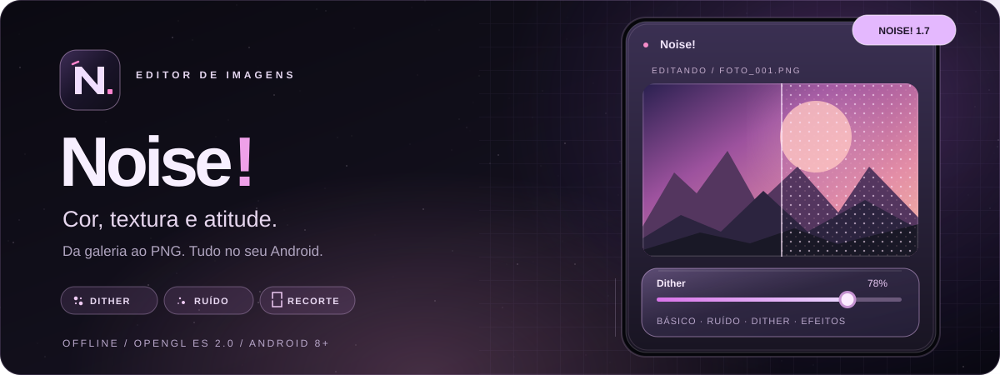
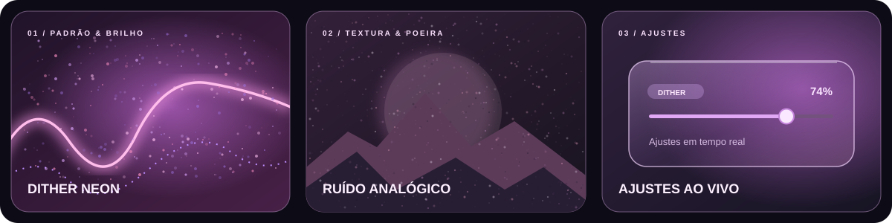
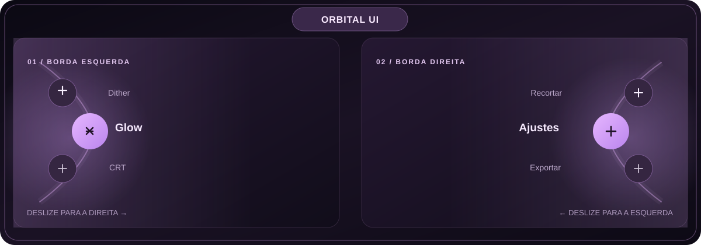

<div align="center">



<br/>

<strong>Uma imagem. Mil possibilidades.</strong>

Editor de imagens para Android com <strong>ajustes em tempo real</strong>, efeitos experimentais, <strong>Dither</strong>, <strong>ASCII</strong> e uma interface de edição com <strong>rodas orbitais</strong> e <strong>câmera com ajustes ao vivo</strong>.

<br/>

<a href="https://github.com/DiscNet/Noise/releases/latest"></a>
<a href="https://github.com/DiscNet/Noise/releases/latest"></a>

<br/><br/>


<a href="https://github.com/DiscNet/Noise/actions/workflows/android.yml"></a>

<br/>

<a href="#-laboratório-de-efeitos"><strong>Explorar os efeitos</strong></a> · <a href="#-navegação-orbital"><strong>Navegação orbital</strong></a> · <a href="#-instalação"><strong>Como instalar</strong></a> · <a href="#-desenvolvimento"><strong>Código e build</strong></a>

</div>

---

## ✦ Um editor feito para experimentar

O **Noise!** combina os ajustes essenciais de fotografia com ferramentas criativas e uma interface feita para aproveitar melhor o espaço do celular. O processamento utiliza **shaders na GPU**, enquanto as edições são armazenadas como parâmetros — a imagem original do projeto permanece intacta.

<table>
<tr>
<td width="50%" valign="top">

### 🎛️ Precisão na edição

**Luz e cor** com visualização ao alterar o controle, valores ajustáveis, comparação com o original, histórico de desfazer/refazer e edição não destrutiva.

</td>
<td width="50%" valign="top">

### ✨ Experimentação visual

**Glow, ruído, Dither, CRT, Glitch, ASCII e mais** para criar texturas e estilos além dos filtros convencionais.

</td>
</tr>
<tr>
<td valign="top">

### ◌ Estúdio e interface orbital

Home com **tinta procedural na GPU**: massas que se deformam, fundem e se separam, com bordas de tinta granuladas e reflexos violeta, além de resposta suave ao toque. Perfis Alto, Equilibrado e Econômico, ajuste automático e redução de movimento nas configurações. **Cartões foscos sem vidro**, círculo preservado e cantos de 6 a 7 dp. No editor, as rodas laterais têm **crossfade contínuo de ícones** e ligação líquida por metaballs.

</td>
<td valign="top">

### 📁 Tudo no dispositivo

Galeria por álbuns, projetos locais, presets, recorte, exportação em **PNG/JPEG** e compartilhamento pelo Android — sem depender de conexão.

</td>
</tr>
</table>

## 🎨 Laboratório de efeitos

<div align="center">

<sub>Artes conceituais da identidade visual; não são capturas de tela do aplicativo.</sub>
</div>

<br/>

| Módulo | Recursos |
| :-- | :-- |
| ☀️ **Luz** | Exposição, brilho, contraste, realces, **Brancos**, pretos e sombras |
| 🎨 **Cor** | Saturação, vibração, temperatura, tonalidade, matiz e inversão |
| 🔍 **Detalhes** | Nitidez, textura, ruído, granulação, aspereza e realce de bordas |
| ✨ **Efeitos** | **Glow** com intensidade/limiar/raio, vinheta, Fade, CRT, Glitch, anéis, névoa e aberração cromática |
| ▦ **Dither** | Neon/Nonqual, Bayer e Threshold; paletas coloridas, monocromáticas e RGB |
| ▤ **ASCII** | Imagem formada por caracteres, com densidade, contraste, brilho, limiar, espaçamento e símbolos |
| ✂️ **Ferramentas** | Recorte, rotação, espelhamento, presets, projetos e exportação |
| 📷 **Câmera** | CameraX com JPEG em alta resolução, foco por toque, zoom exclusivo pela moldura e prévia imóvel; modo TELA sem bordas em 1×, proporções que seguem a posição do celular, régua mais suave e alinhamento fotográfico |

> **Mais controle, menos efeitos artificiais:** cada ajuste conserva seus próprios parâmetros. Glow e Brancos usam curvas de processamento desenvolvidas para responder também em imagens com luminosidades diferentes.

## ◉ Navegação orbital

<div align="center">



<sub>Representação gráfica das rodas, ilustrativa e não uma captura real.</sub>

</div>

<br/>

A navegação foi pensada para não atrapalhar o manuseio da imagem:

| Gesto | Resultado |
| :-- | :-- |
| **Deslizar da borda esquerda → direita** | Abre **Efeitos**, em roda do lado esquerdo |
| **Deslizar da borda direita → esquerda** | Abre **Ferramentas**, em roda do lado direito |
| **Arrastar verticalmente na roda** | Gira entre as opções com rolagem amortecida |
| **Fechar o menu** | Menu e fundo desaparecem com **fade out** |

As rodas descrevem arcos circulares espelhados. A abertura tem animação própria — **não acompanha rigidamente o dedo** — e o editor escurece gradualmente com um gradiente suave.

## 📷 Fluxo de edição

1. **Importe ou fotografe:** abra uma foto da galeria ou toque em **Câmera** na tela inicial. Na câmera, ajuste saturação, temperatura e exposição em tempo real, capture e, se desejar, toque em **Editar**.
2. **Ajuste a imagem** nos controles de luz, cor e detalhes, acompanhando a prévia.
3. **Explore os efeitos** nas rodas laterais e combine Dither, Glow, ASCII e outros estilos.
4. **Compare e refine** com o original, desfaça/refaça e salve seu projeto ou preset.
5. **Exporte e compartilhe** em PNG ou JPEG; o arquivo é salvo em `Pictures/Noise!`.

## 📦 Instalação

<div align="center">

<a href="https://github.com/DiscNet/Noise/releases/latest"></a>

</div>

Acesse a [**última release publicada**](https://github.com/DiscNet/Noise/releases/latest), baixe o APK **`Noise.V<versão>.apk`** disponível nos assets e abra-o no Android para instalar. Caso necessário, autorize a instalação a partir do aplicativo usado para abrir o APK.

- **Sistema mínimo:** Android 8.0 (API 26).
- **Primeira abertura:** o Noise! solicita acesso às fotos; se você não conceder, ainda poderá usar o seletor de imagens do sistema.
- **Armazenamento:** as fotos exportadas permanecem em **`Pictures/Noise!`** mesmo após desinstalar o app.

> **Nota:** imagens exportadas permanecem em `Pictures/Noise!`. Para preservar projetos após desinstalar, use **Meus projetos → Proteger projetos após desinstalar** e vincule uma pasta pública; depois de reinstalar, escolha novamente a mesma pasta. Consulte o [guia de atualizações](docs/APK-UPDATES.md) antes de migrar de uma instalação com assinatura diferente.

## ⚙️ Desenvolvimento

O Noise! é escrito em **Java**, com componentes Android e renderização **OpenGL ES 2.0**. Os efeitos são executados por shaders GLSL; a prévia e a exportação usam a mesma base de ajustes.

| Camada | Tecnologia |
| :-- | :-- |
| Interface | Android View System · Java |
| Renderização | OpenGL ES 2.0 · GLSL |
| Imagens e galeria | Bitmap · MediaStore |
| Build | Gradle 8.9 · Java 17 · Android SDK 35 |
| Verificação | GitHub Actions · testes instrumentados em emulador Android |

Para compilar localmente, instale o **JDK 17**, o **Android SDK 35** e o **Gradle 8.9**:

```bash
gradle --no-daemon assembleDebug assembleDebugAndroidTest
```

O APK de debug será gerado em `app/build/outputs/apk/debug/app-debug.apk`. O workflow executa os testes instrumentados e, na branch `main`, compila e verifica o APK **release sem depuração**, assinado com uma keystore permanente, antes de publicá-lo nas [Releases](https://github.com/DiscNet/Noise/releases). Também pode ser iniciado em **Actions → Build Noise APK → Run workflow → main**.

A publicação exige os quatro Repository Secrets descritos no [guia de assinatura permanente](docs/APK-UPDATES.md). As prévias de debug são identificadas por `-preview.apk` e não substituem a instalação oficial por atualização.

<details>
<summary><b>🗂️ Estrutura do projeto</b></summary>

```text
app/src/main/java/com/discnet/noise/
├── MainActivity.java          # Navegação e ciclo de vida
├── OrbitalSelector.java       # Rodas laterais e animações
├── SwipeNavigationHost.java   # Reconhecimento dos gestos nas bordas
├── EditorPanel.java           # Controles de ajustes
├── EditState.java             # Estado enviado à GPU
├── GlPipeline.java            # Pipeline OpenGL
├── GalleryScreen.java         # Fotos e álbuns
└── ExportManager.java         # Arquivos exportados

app/src/main/assets/
├── editor.frag                # Efeitos e renderização final
└── tone.frag                  # Ajustes de cor e luz

.github/assets/               # Identidade visual do README
.github/workflows/android.yml # Build, validação e publicação
```

</details>

<details>
<summary><b>🧪 Testes e limitações</b></summary>

A suíte de instrumentação verifica shaders, ajustes, comparação com o original, efeitos, galeria, importação, recorte, projetos, histórico e exportação. Veja a [documentação de validação](docs/VALIDATION.md) e as [notas da V1.37.1](docs/RELEASE-1.37.1.md).

**Ainda não implementado:** máscaras locais, curvas RGB, Dither por difusão de erro Floyd–Steinberg/Atkinson e exportação ilimitada. Alguns detalhes podem variar entre a prévia reduzida e a exportação em resolução maior.

</details>

---

<div align="center">


<br/><br/>

<strong>Experimente. Ajuste. Transforme.</strong>

<a href="https://github.com/DiscNet/Noise/releases/latest"><strong>Baixar Noise!</strong></a> · <a href="https://github.com/DiscNet/Noise/issues"><strong>Reportar um problema</strong></a> · <a href="docs/RELEASE-1.37.1.md"><strong>Notas da versão</strong></a>

<sub>Inspirado por fluxos de edição de imagem como Photopea e Lightroom Mobile. Noise! é um projeto independente.</sub>

</div>
